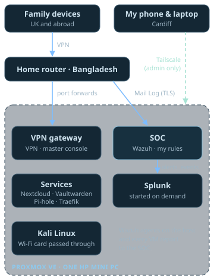

# JAT Cipherline 2300 — security lab (public reference)

A self-hosted VPN gateway and home **security operations lab** that I design, build and
run on a single Proxmox mini-PC, and administer remotely over a private network.
This repository is the **public, sanitised** part of that project: the detection code I
actually run, reference implementations of the security patterns the lab is built on,
and the architecture behind it.

**Portfolio:** <https://jubairahammedtushar.com/> · **Case studies:**
[VPN gateway & lab](https://jubairahammedtushar.com/#cipherline) ·
[home SOC](https://jubairahammedtushar.com/#home-soc)

> **What is and isn't here.** The live installers, configurations, addresses, endpoints,
> hostnames, keys and any user data are **deliberately not published** — this is a system
> my family depends on. What's here is the genuinely reusable, non-sensitive work:
> real detection rules and a tested log receiver, plus clean reference implementations of
> the access-control and hardening techniques. Example addresses use documentation and
> private ranges only (`127.0.0.1`, `192.168.0.0/16`, [RFC 5737](https://datatracker.ietf.org/doc/html/rfc5737)
> `203.0.113.0/24`, [RFC 6598](https://datatracker.ietf.org/doc/html/rfc6598) `100.64.0.0/10`).

## What the lab is

Five virtual machines on one Proxmox VE host:

| VM | Role |
| --- | --- |
| Gateway | Multi-protocol VPN for the household, plus a firewall and the activity meter |
| Services | Private cloud storage, a password manager and DNS filtering behind a reverse proxy |
| SOC | A SIEM manager with my own decoders and rules (see [`detections/`](detections/)) |
| Analytics | A log-analytics server, started on demand to save memory |
| Kali | An offensive-security VM with a passed-through Wi-Fi card, for authorised testing on my own network |

A single web console manages the fleet: it signs in with a password plus a one-time code
or a passkey, keeps an audit log, shows live latency and packet-loss charts, and runs lab
jobs (start/stop/back up VMs, apply updates, memory savers).



See **[docs/architecture.md](docs/architecture.md)** for the full write-up.

## How it's built (honestly)

- **AI-assisted engineering.** I set the requirements, the security rules and the
  acceptance tests, and I deploy, test and operate every release on the real hardware.
  Much of the code was written with an AI coding assistant, and I work through unfamiliar
  tools and techniques with AI-assisted research rather than from prior knowledge.
- **Change discipline.** Every change is proposed, approved and reversible, with a
  rollback path prepared before anything disruptive, and work elsewhere never interrupts
  the running VPN.
- **Tested before release.** Several hundred automated checks run against stand-in
  machines before each release; the detection code here ships with its own tests
  (see CI).

## What's in this repository

| Path | What it is | Status |
| --- | --- | --- |
| [`detections/`](detections/) | The Wazuh decoders and rules I run, and a small SMTP-over-TLS receiver that brings my router's Mail Log into the SIEM, with **36 tests** against the real receiver | Real, running code |
| [`examples/ssh-forced-command/`](examples/ssh-forced-command/) | A forced-command wrapper: one SSH key, a fixed allow-list of jobs with validated arguments, never a shell | Reference implementation |
| [`examples/systemd-hardening/`](examples/systemd-hardening/) | A hardened `systemd` service unit with sandboxing directives, annotated | Reference implementation |
| [`examples/secrets-on-stdin/`](examples/secrets-on-stdin/) | The pattern for passing secrets on standard input, never on the command line, in the environment or in logs | Reference implementation |
| [`examples/idle-watch/`](examples/idle-watch/) | The activity-aware idle detector that lets batch jobs wait for a quiet link before acting | Reference implementation |
| [`docs/`](docs/) | Architecture write-up and the lab map | Documentation |

The reference implementations in `examples/` are **clean, generic illustrations** of the
techniques used in the private deployment — written to be read and reused, not copied from
the live config.

## Evidence and limits

- Home-lab scale: a handful of machines and family traffic. The detections are tuned by me
  and **have not been independently validated or penetration-tested**.
- The evidence for the running system is my own console screenshots and logs; nothing here
  should be read as an independent audit result.
- Offensive-security work is practice on systems I own or on guided platforms (TryHackMe);
  no scan reports or exploit output are claimed.

## Running the tests

```bash
# Detection receiver — 36 checks against the real receiver (Python 3.9+, stdlib + openssl)
python3 detections/router-mail/test-router-mail.py

# Reference implementations
python3 examples/idle-watch/test_idle_watch.py
bash    examples/ssh-forced-command/test-forced-command.sh
```

CI runs all of these on every push (see [`.github/workflows/ci.yml`](.github/workflows/ci.yml)).

## Licence

[MIT](LICENSE) — the code and reference implementations are free to read, run and reuse.
