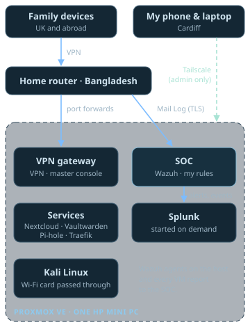

# Architecture

A sanitised overview of how JAT Cipherline 2300 is put together and why. No real
addresses, hostnames, endpoints, ports of private services, or keys appear here.

## Design goals

1. **One small machine, clear separation.** Run a household VPN, private services, a SOC
   and an offensive-security lab on a single Proxmox mini-PC, with each concern on its own
   VM and no trust bridged between them without a reason.
2. **Nothing admin-facing on the internet.** The VPN is the only service that accepts
   inbound connections from the public internet. Every management surface — the hypervisor,
   SSH, the web console — is reachable only over a private overlay network.
3. **Least privilege everywhere.** A component gets exactly the access it needs to do its
   job, and no shell where a fixed command will do.
4. **Every change reversible.** Nothing changes the running system without an approved,
   rollback-able step, and routine work never interrupts the family's VPN.

## The five VMs

- **Gateway** — terminates the household VPN (several protocols, so it keeps working on
  networks that block the common ones), runs the firewall and NAT, and publishes a small
  **activity meter** (per-device throughput) that batch jobs read to avoid acting while
  someone is online. Each person has their own account and devices, with a per-person
  switch for access to the home network.
- **Services** — private cloud storage, a password manager and a DNS filter behind a
  reverse proxy with automatically renewed certificates. Reachable only on the home
  network, over the VPN, or from my own devices over the private overlay.
- **SOC** — a SIEM manager with agents on the host and every VM. Custom decoders and rules
  for VPN sessions, console sign-ins, firewall blocks, DNS-filter summaries, the password
  manager and the home router. After each install a sample of every log type is replayed
  through the SIEM's rule tester as a self-test. See [`../detections/`](../detections/).
- **Analytics** — a log-analytics server for dashboards and search, started on demand to
  save memory.
- **Kali** — an offensive-security VM with a Wi-Fi card passed through to it, used for
  authorised wireless auditing, man-in-the-middle and OSINT practice on networks and
  accounts I own.

## Access and identity

The techniques below have runnable reference implementations under
[`../examples/`](../examples/).

- **Admin only over a private overlay.** The hypervisor, SSH and the web console are never
  exposed to the internet; remote administration goes over a private mesh overlay between
  my own devices and the lab.
- **Two-step console sign-in.** Console accounts use a password plus a one-time code or a
  passkey. Every sign-in and every administrative action is written to an audit log.
- **Phone-confirmed, time-boxed controls.** Destructive lab controls stay locked until I
  confirm a fresh code from my phone, and lock themselves again after a short window.
- **Forced-command SSH.** The console reaches each machine through a single SSH key that is
  pinned to a fixed allow-list of jobs with validated arguments — never an interactive
  shell. → [`../examples/ssh-forced-command/`](../examples/ssh-forced-command/)
- **Secrets on standard input.** Credentials are passed to tools on `stdin`, never on the
  command line, in the environment or in logs. → [`../examples/secrets-on-stdin/`](../examples/secrets-on-stdin/)
- **Sandboxed services.** Long-running services run under `systemd` with the kernel's
  sandboxing turned up. → [`../examples/systemd-hardening/`](../examples/systemd-hardening/)

## Detection engineering

The SOC favours a few high-signal, self-tested rules over noise:

- Custom decoders turn each device's log lines into structured fields; custom rules raise
  alerts at sensible levels. A worked example is the **router Mail Log receiver**: the
  router can only *email* its log, so a small SMTP-over-TLS listener accepts mail **only**
  from the router, never relays, skips lines it has already seen, and feeds new lines to
  the SIEM. It ships with 36 tests. → [`../detections/`](../detections/)
- A real finding from building it: the SIEM evaluates top-level rules highest-level-first,
  so a generic "authentication failure" rule was claiming the router's "login failed"
  lines before the router rule could match. The fix was to re-parent the router rules under
  a higher-level group so they match first. The rule tester (`wazuh-logtest`) is used as a
  regression check after every change.

## Operating discipline

- **Idle-aware batch work.** Updates, reboots and backups wait for a quiet link: the
  activity meter reports per-device throughput, and a job proceeds only after several
  consecutive quiet checks, so maintenance never lands in the middle of a video call.
  → [`../examples/idle-watch/`](../examples/idle-watch/)
- **Rollback before change.** A rollback point is prepared before any potentially
  disruptive step; the console can restore it without touching the running VPN.
- **Tested before release.** Several hundred automated checks run against stand-in machines
  before each release.
